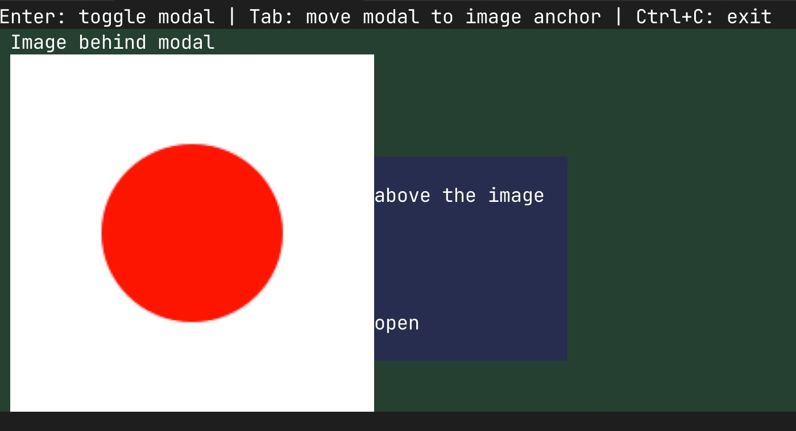

# Image/modal reproduction

Run from the repository root in cmux, Ghostty, Kitty, or WezTerm (at least 80 columns and 32 rows):

```sh
npm ci --ignore-scripts
node packages/tui/test/image-overlay-demo.ts
```

This uses Pi's fullscreen TUI and `showOverlay`, without an API key or extension.

- The modal opens across the image body.
- Press **Enter** to close and reopen it.
- Press **Tab** to move it across the image's first row, then back across its body.
- Press **Ctrl+C** to exit before switching branches.

On `florent.legall/tui-image-overlay-repro`, the image covers the left part of the modal while its right side stays visible.
On `florent.legall/tui-image-overlay-fixed-demo`, the modal is readable, the image remains visible around it, and closing restores the full image.

These branches are for checkout only. Keep discussion on the fix PR; do not merge these demos.


