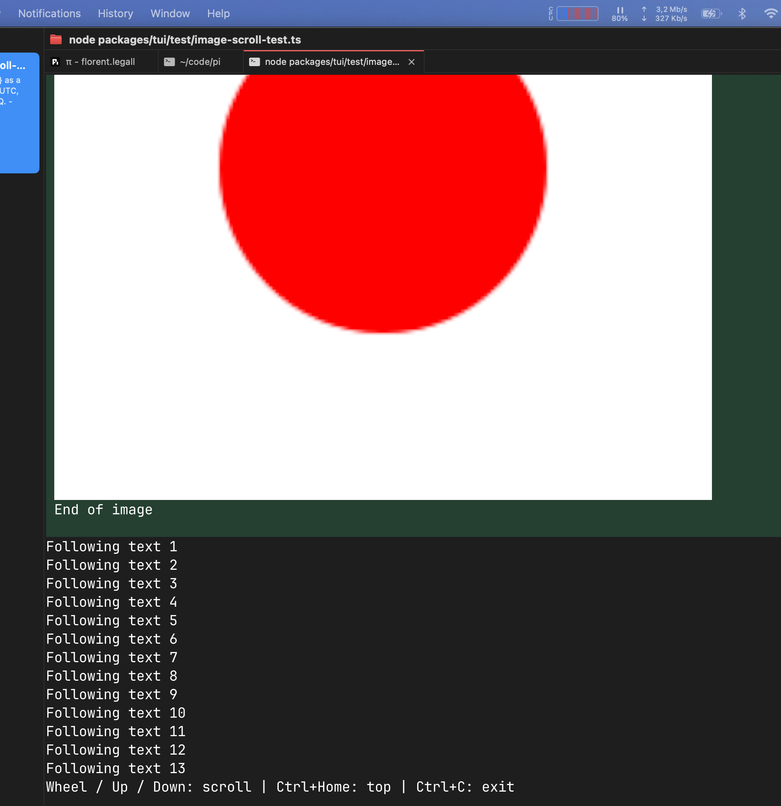

# Image scrolling demonstration

Illustrative branch only; do not merge the demo files. The production fix and regression tests are in [the fix PR](https://github.com/flegall/pi/pull/1).

From the repository root, with Node.js >=22.19 and dependencies installed:

```sh
npm ci --ignore-scripts
node packages/tui/test/image-scroll-test.ts
```

Use a terminal supporting Kitty graphics, such as cmux or Ghostty. The demo runs Pi's fullscreen TUI directly; it does not require an agent session, API key, or model.

1. Scroll with the wheel or Up/Down until the image's first row is above the viewport.
2. The visible portion of the image remains rendered after its first row leaves the viewport.
3. Scroll beyond the entire image: only the following text should remain.
4. Press Ctrl+Home to return to the image, or Ctrl+C to exit.

Also try shrinking the terminal below the image height and scrolling in both directions.

Run the automated regression from the repository root:

```sh
cd packages/tui
node --test test/layout-image-scroll.test.ts
```

All three regression cases pass.

Screenshot from the manually verified reproduction (captured before packaging these branches):


